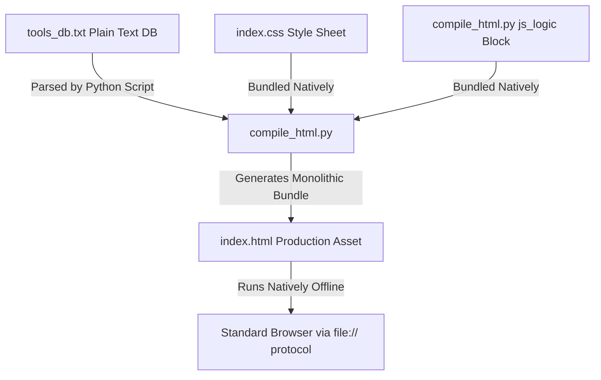

# AI Tool Finder 2026 — The Digital Futurist

A premium, highly interactive, cyber-punk themed search and discovery directory indexing **exactly 200 real, verified real-world AI tools** across 12 distinct categories. Built with modern clientside scoring algorithms, a robust, accessible HTML5 `<dialog>` details popup, dynamic neon category color coding, and a high-fidelity filter visual sync system.

This application is fully responsive and completely self-contained within a monolithic production asset, allowing it to execute offline directly under standard browser `file://` protocols with **zero external server dependencies, CORS restrictions, or Node runtime requirements**.

---

## 🚀 Key Features

* **Multi-Constraint Intelligent Scoring Engine**
  * Evaluates and ranks all 200 tools dynamically in real-time according to user-selected monthly budgets (via neon range slider), latency requirements, team sizes, and specific category checkboxes.
  * Performs weighted keyword search queries across tool names, feature descriptions, pricing structures, and raw user reviews to surface the **Top 10 Best Matches** with calculated percentage scores.
* **Flawless Filter Selection UX**
  * Built using native clientside checkbox `change` event listeners that visual-sync instantly with active CSS status classes.
  * Completely resolves classic double-triggering checkbox click bubbles, providing bulletproof mouse, trackpad, and keyboard accessibility interactions.
* **Dynamic Neon Color Coding**
  * Custom neon themes styled uniquely for all 12 categories, mapping dynamic CSS variables (`--cat-color` and `--cat-bg`) at render-time.
  * Search result cards (`.card`) inherit top accent indicators and hover-glow shadows colored according to their category.
  * Explorer grid cards (`.mc`) and category names (`.mc-cat`) glow and highlight dynamically, bringing immediate structural clarity to the visual taxonomy.
* **Interactive Native Dialog Modals**
  * Utilizes native, accessible HTML5 `<dialog>` elements for detailed card popup profiles.
  * Natively supports keyboard focus trapping, boundary click dismissal, and standard `ESC` key closures.
* **The Digital Futurist Branded Footer**
  * Rebuilt to perfectly synchronize with the personal brand, description, and link grid from [thomascherickal.github.io](https://thomascherickal.github.io).
  * Includes a styled newsletter subscription card directing users to **The Digital Futurist Newsletter** hosted on Kit.com.
  * Features a beautifully designed dark glassmorphic social links grid displaying 27 verified profile avenues (LinkedIn, GitHub, GitLab, HackerNoon, Medium, Substack, Patreon, Gumroad, Topmate, LeetCode, etc.).

---

## 🛠️ Architecture & Compilation Pipeline

The codebase is organized in a segregated, developer-friendly modular structure that compiles into a highly optimized, single-page bundle for seamless offline distribution:



### File Registry

* **`/index.html`** — The compiled monolithic single-page application. This is the production asset for users and deployment.
* **`/index.css`** — The global stylesheet housing variables, linear card gradients, custom neon category color definitions, sliders, and responsive layout queries.
* **`/app.js`** — The raw segregated clientside script implementing the constraint matching, scoring algorithms, details modals, and explorer card grid routines.
* **`/tools_db.txt`** — The plain-text database containing all 200 real, verified AI tools (updated with versions like GPT-5.5, Claude Sonnet 4.6, Claude Opus 4.7, Gemini 3.5 Flash, Gemini 3.1 Pro, Midjourney v8.1, Suno v5.5, FLUX.2, Llama 4 Maverick, Runway Gen-4.5, Perplexity Pro, Zapier Central, n8n, CrewAI, Notion AI, Julius 1.2 Ultra, and the discontinuations of Sora and Tome valid as of **May 28, 2026**) with scores, prices, descriptions, and exactly three reviews (two positive, one negative) each.
* **`/package.json`** — Standard npm metadata providing local developer serving scripts.
* **`/compile_html.py`** — The Python compiler pipeline that parses `tools_db.txt` and compiles the production `index.html` asset.

---

## 🎨 Category Styling Guide

Each of the 12 categories has been mapped to a distinct, high-impact neon color variable to bring a premium, structural aesthetic to the tool explorer:

| Category | Accent Color | Variable Prefix | Hex Value |
| :--- | :--- | :--- | :--- |
| **LLM/Chat** | Cyan Glow | `cat-llm-chat` | `#00d4ff` |
| **Coding** | Emerald Neon | `cat-coding` | `#00ff88` |
| **Image Gen** | Electric Purple | `cat-image-gen` | `#c07aff` |
| **Video Gen** | Vivid Red | `cat-video-gen` | `#ff5252` |
| **Audio/Voice** | Teal Aqua | `cat-audio-voice` | `#00ffd5` |
| **Writing** | Golden Honey | `cat-writing` | `#ffbb00` |
| **SEO/Marketing** | Solar Yellow | `cat-seo-marketing` | `#ffff00` |
| **Automation** | Amethyst Purple | `cat-automation` | `#a855f7` |
| **Research** | Hot Pink | `cat-research` | `#ec4899` |
| **Productivity** | Crimson Rose | `cat-productivity` | `#f43f5e` |
| **Design** | Sunset Orange | `cat-design` | `#f97316` |
| **Data/Analytics** | Mint Green | `cat-data-analytics` | `#10b981` |

---

## 💻 Setup & Development

### 1. Natively Running Natively (No Setup)
Simply double-click the compiled `index.html` file in your desktop file manager, or open it in any web browser:
```bash
# Example launching on Linux
xdg-open index.html
```

### 2. Local Development Server
To work with the segregated files without triggering browser CORS blocks, run a lightweight clientside dev server:
```bash
# 1. Install dependencies
npm install

# 2. Launch the developer server (runs http-server on port 8080)
npm run dev
```

### 3. Recompiling the Production Build
Whenever you edit [tools_db.txt](file:///home/thomas/Digital%20Products/Patreon/Top%2010%20AI%20Tools%20Finder/tools_db.txt), [index.css](file:///home/thomas/Digital%20Products/Patreon/Top%2010%20AI%20Tools%20Finder/index.css), or the script structures inside the compiler, execute the Python compilation pipeline to regenerate `index.html`:
```bash
python3 compile_html.py
```

---

## 👤 Author Credits

**Thomas Cherickal**  
*AI Consultant · Open Source Gen AI Developer · Independent Research Blogger at [The Digital Futurist](https://thomascherickal.com/)*  

* **Expertise:** Gen AI · SLMs/LLMs · AI Agents · RAG · Quantum Computing · Blockchain · Web3 · Cybersecurity · Python · Golang · Rust · Mojo
* **Consulting:** [📅 Book a 1-on-1 Consult](https://topmate.io/thomascherickal)
* **Products:** [🛒 Digital Products Store](https://thomascherickal.gumroad.com)
* **Exclusive Content:** [🎗 Patreon Page](https://www.patreon.com/thomascherickal)
